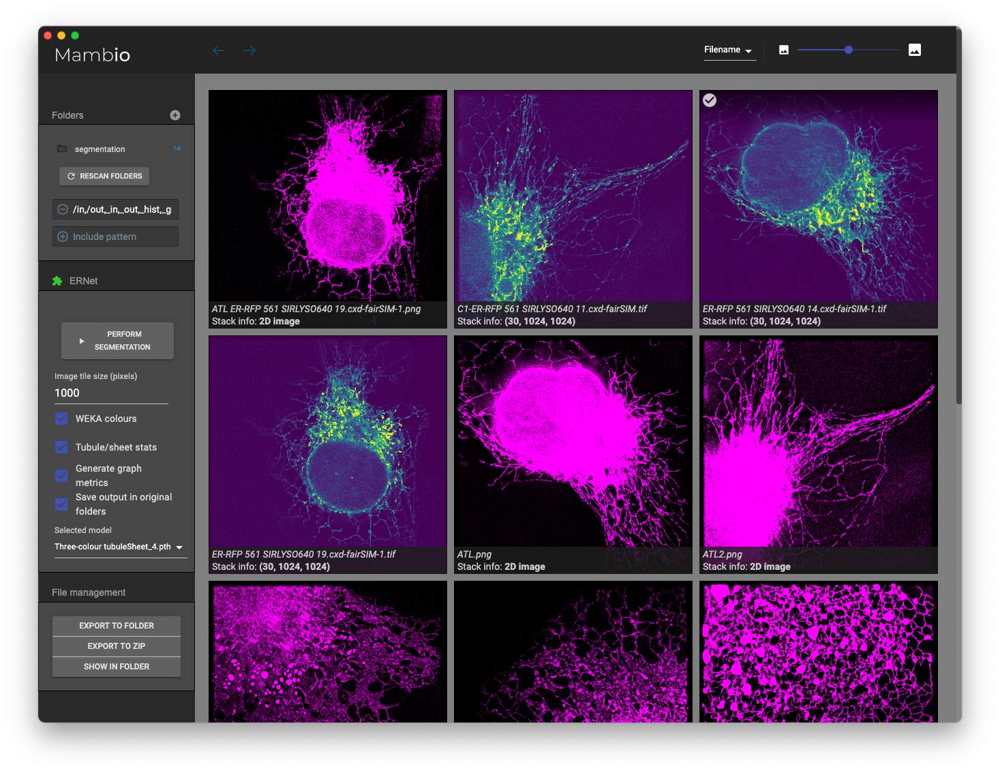

# Mambio, the ERnet desktop app

Mambio is the desktop app that came with the paper. It shows the images in a folder as thumbnails, segments the ones you select with ERnet and displays the results. The interface is an Electron app and the segmentation runs in a Python process.

<p align="center">
  
</p>

## Status

This copy of the app is not maintained, and its installation instructions no longer work. The source stays here for reference.

- The interface was developed against Node.js 13 and Electron 6, both from 2019. Electron 6 has no build for Apple Silicon.
- `yarn download-models` fetched the weights from a storage bucket that has been deleted.
- The Python setup pins Python 3.6 and PyTorch 1.8.1. pip has no PyTorch 1.8.1 build for the Python versions in use today.

## What to use instead

[`segment.py`](../README.md#try-it) in the root of this repository runs the same model from a terminal. It processes any number of images and stacks in one call and writes the segmentation, the skeleton graph and a table of metrics.

```bash
pip install -r requirements.txt
python segment.py path/to/images/*.tif --out results
```

The [Colab notebook](https://colab.research.google.com/github/charlesnchr/ERnet-v2/blob/main/ERnet.ipynb) does the same in a browser.

If you need a graphical interface, the [ML-SIM repository](https://github.com/charlesnchr/ML-SIM/tree/master/Graphical-App) has a maintained version of the app on Electron 45, with an ERnet plugin. That plugin runs an earlier residual network with three classes: background, tubule and sheet. It has no class for sheet-based tubules, and the transformer model of this repository has not been ported to it.

## If you want to revive it

| Path | Contents |
| --- | --- |
| `public/` | Electron main process |
| `src/` | The React interface. `Plugin_ERNet.js` is the ERnet side panel |
| `pyengine/pysrc/` | The Python engine. `engine.py` is the socket server and `ernet.py` runs the model |
| `util/download_models.js` | The model downloader that points at the deleted bucket |

The engine expects the weights at `pyengine/models/20220306_ER_4class_swinir_nch1.pth`. The file is on the [v2.0 release](https://github.com/charlesnchr/ERnet-v2/releases/tag/v2.0). The ML-SIM copy of the app was moved to Electron 45 and Vite in November 2026. The two copies share most of their code, and that repository's history shows the steps.
