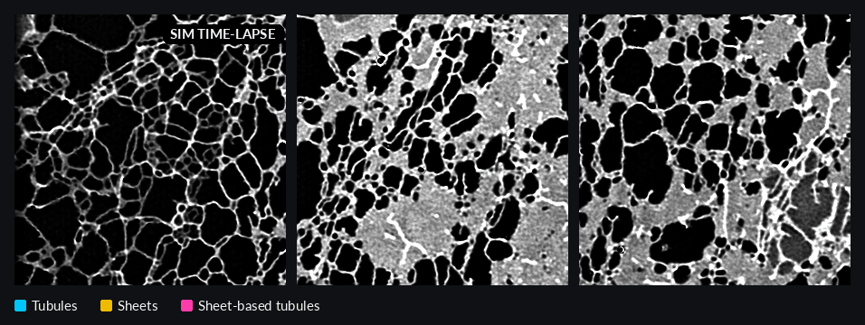
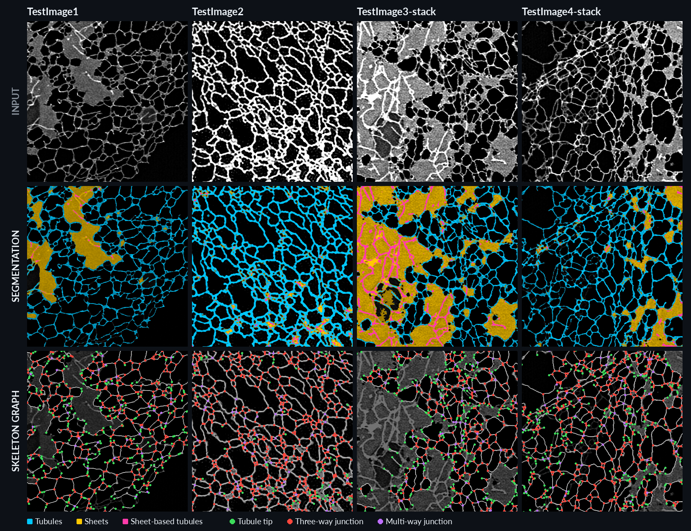
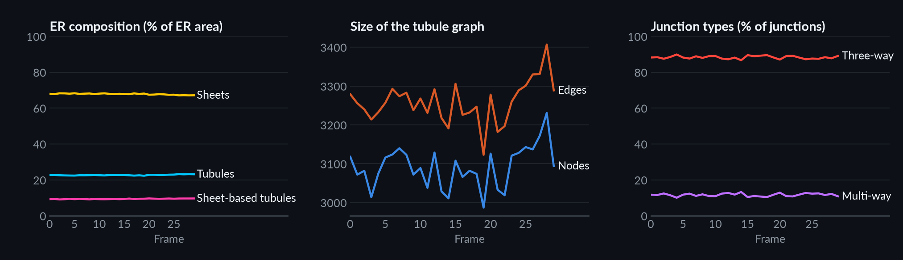
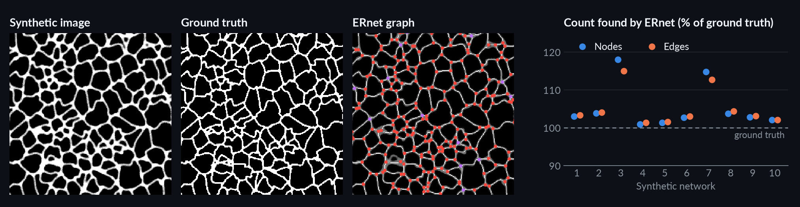
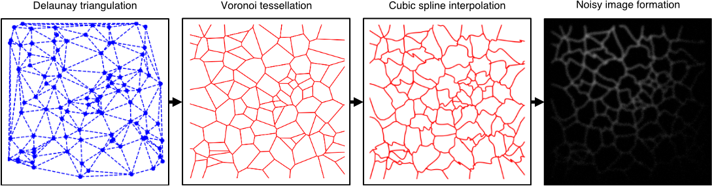

<h1 align="center">ERnet</h1>

<p align="center">
  <b>Turn images of the endoplasmic reticulum into a network you can measure.</b><br>
  A vision transformer labels every pixel as tubule, sheet or sheet-based tubule.<br>
  The tubules become a graph, and the graph puts numbers on the shape of the ER.
</p>

<p align="center">
  <a href="https://doi.org/10.1038/s41592-023-01815-0"></a>
  <a href="https://doi.org/10.1101/2022.05.17.492189"></a>
  <a href="https://colab.research.google.com/github/charlesnchr/ERnet-v2/blob/main/ERnet.ipynb"></a>
  <a href="https://doi.org/10.6084/m9.figshare.21975878"></a>
  <a href="LICENSE"></a>
</p>

<p align="center">
  
</p>
<p align="center">
  <sub>Three crops of a 30-frame SIM time-lapse of the ER, segmented and converted to a graph by the model in this repository. Run <code>python fig/make_figures.py</code> to reproduce it.</sub>
</p>

The endoplasmic reticulum (ER) is the largest membrane structure in the cell, a net of thousands of tubules joined to flat sheets that rewires itself within seconds. Its shape changes in disease, and for a long time those changes could only be described in words. The standard way to pick the ER out of an image was an intensity threshold, which cuts thin tubules wherever the signal dips and leaves no network worth counting.

ERnet replaces the threshold with a network that has learned what tubules and sheets look like. Once every pixel has a class, the tubules are thinned to a skeleton and turned into a graph, with junctions as nodes and tubules as edges. From there the questions have numerical answers. How many junctions are there, how many tubules meet at each, and is the network one connected piece or has it fallen apart?

- **Published in Nature Methods.** [Lu, Christensen et al., 2023](https://doi.org/10.1038/s41592-023-01815-0), cited about 50 times.
- **Four classes per pixel.** Background, tubules, sheets and sheet-based tubules. The last are tubules that run across the face of a sheet. The paper describes them as a structure of their own and finds them to be a common feature in an analysis of 500 cells.
- **Topology as numbers.** Every frame gives the nodes and edges of the tubule graph, the degree of each junction, assortativity, clustering, the number of disconnected fragments and the share of the network in the largest one.
- **Sensitive to disease phenotypes.** In the paper, knocking out atlastin shrinks the largest connected fragment from 90% of all nodes to 4.5%, and the share of three-way junctions falls from 65% to 22%.
- **Not tied to one microscope.** The paper applies the same model to SIM, wide-field, confocal and Airyscan images, and to COS-7, U2OS, HEK, CHO and SH-SY5Y cells, primary neurons and glia, without retraining.
- **Checked against ground truth.** With the released weights, the node and edge counts on the paper's ten synthetic networks come out a median of 3% from the truth. The [test](#against-ground-truth) is part of the figure script.
- **Small.** 0.59 million parameters in a 7 MB file. It runs on four CPU cores at about 40 s per 1024x1024 frame, or on a free GPU in Colab.

## Try it

```bash
git clone https://github.com/charlesnchr/ERnet-v2 && cd ERnet-v2
pip install -r requirements.txt
python segment.py --demo
```

The demo downloads the pre-trained weights (7 MB), one SIM image and a 5-frame SIM time-lapse (6 MB), and segments them. On four CPU cores that takes about four minutes. A GPU is used when one is available.

To run it on your own data, pass the files.

```bash
python segment.py cell.png timelapse.tif --out results
```

Inputs are greyscale PNG, JPG or TIFF images, or TIFF stacks with one frame per time point. Each frame is stretched between its 1st and 99th percentile, so the bit depth does not matter. Frames larger than 1024 px are processed in overlapping tiles.

Everything lands in the output folder.

| File | Contents |
| --- | --- |
| `NAME_classes.png` | The class of every pixel as a grey value: 0 background, 85 sheet, 170 sheet-based tubule, 255 tubule |
| `NAME_colour.png` | The same in colour: tubules cyan, sheets yellow, sheet-based tubules pink |
| `NAME_graph.png` | The skeleton of the tubules over the input, with tips in green, three-way junctions in red and junctions of more than three tubules in violet |
| `NAME_summary.png` | One figure with the input, the segmentation, the graph and the measurements |
| `ernet_metrics.csv` | One row per frame with the class fractions and the graph metrics |

A stack gives TIFF stacks in place of the PNG files, with one output frame per input frame.

If you would rather not install anything, the [Colab notebook](https://colab.research.google.com/github/charlesnchr/ERnet-v2/blob/main/ERnet.ipynb) runs the same script in the browser and reads your images from Google Drive.

## Results

The four test acquisitions on the [v2.0 release](https://github.com/charlesnchr/ERnet-v2/releases/tag/v2.0) are SIM images of the ER, two single frames and two time-lapses. Each column below is a 380 px crop of one of them, with the output of `segment.py`.

<p align="center">
  
</p>

A time-lapse turns into a table with one row per frame. Over the 30 frames of `TestImage4-stack.tif` the composition of the ER barely moves. Tubules stay at 22 to 23% of the ER area, sheets at 67 to 68% and sheet-based tubules at 9 to 10%. The graph underneath keeps rewiring, between 2,987 and 3,231 nodes and between 3,123 and 3,407 edges. In every frame 87 to 90% of the junctions are three-way junctions. The paper reports the same pattern in its recordings, stable proportions of tubules and sheets under a fluctuating number of nodes and edges.

<p align="center">
  
</p>

### Against ground truth

A segmentation of real ER has no ground truth for its graph, so the paper tests the graph extraction on synthetic networks. A random network with a known skeleton is rendered with blur and noise, ERnet segments the image, and the graph it finds is compared with the true one. `fig/make_figures.py` repeats that test with the released weights on the ten networks published with the paper.

<p align="center">
  
</p>

ERnet finds slightly more nodes and edges than there are. The median excess is 2.9% for nodes and 3.2% for edges. Eight of the ten networks are within 4.3%, and the other two come out 13 to 18% high.

The paper reports 96 to 99% accuracy for nodes and edges on synthetic networks, and 92 to 99% pixel accuracy against labelled SIM images. It finds the output reliable for images with a signal-to-noise ratio above about 5.

### What the paper measured with it

These numbers are from the [paper](https://doi.org/10.1038/s41592-023-01815-0), not from runs in this repository.

- **Atlastin knockout**, a model of hereditary spastic paraplegia. The largest fragment holds 4.5% of the nodes, against 90% in control cells. Three-way junctions fall from 65% to 22% of the nodes, and the assortativity drops to -0.25.
- **U18666A**, which blocks cholesterol export from lysosomes as in Niemann-Pick disease type C. The largest fragment holds 2.6% of the nodes, and the assortativity is -0.34.
- **ATP depletion** with sodium azide. The largest fragment holds 19% of the nodes, a milder break-up than the loss of atlastin causes.
- **Junction lifetimes** in healthy cells. Junctions of more than three tubules last 9.0 s on average, against 30.8 s for three-way junctions.

### Repository structure
The graphical user interface, Mambio, is provided in the folder `Graphical-App`. Instructions and further information can be found in the corresponding README.

Code for training models based on the ERnet architecture can be found in the folder `Training`, and further information is also in the README file of that folder. A script that generates synthetic ER images can be found in `Training/Simulate_ER`, see the [Synthetic data generation pipeline](#synthetic-data-generation-pipeline-for-testing) section.

### Synthetic data generation pipeline for testing

We propose a model for synthesising ground truth ER images with a simple algorithm. First a set of uniformly distributed coordinates are generated. Delaunay triangulation is performed on the coordinates providing a set of triangles. The circumcentre of each triangle becomes a vertex in a Voronoi diagram. The diagram is formed by connecting vertices between adjacent triangles. This procedure is called Voronoi tessellation. Each edge in the undirected graph corresponding to the Voronoi diagram is the perturbed in the following way: the midpoint of an edge is moved in a random direction by a random distance that is smaller than the length of the edge. The displaced midpoint and the two ends of the edge are then used the produce a smooth curve using cubic spline interpolation of the three points. Finally, the network of vertices connected with interpolated curves are processed with a image formation model that applies blur (diffraction) and noise (Poisson noise and Gaussian read-out noise).

<p>
</a>
</p>

The steps of this algorithm are illustrated on the figure above. The implementation can be found in `Training/Simulate_ER`, and the script can be used to generate a collection of test images with
```
python Simulate_ER_images_script.py
```
Parameters are given in the file.

### Preceding work

#### Github repository
[ERNet — Residual network](https://github.com/charlesnchr/ERNet)
<br>
Segmentation of Endoplasmic Reticulum microscopy images using modified CNN-based image restoration models.

#### Science Advances publication
_Meng Lu<sup>1</sup>, Francesca W. van Tartwijk<sup>1</sup>, Julie Qiaojin Lin<sup>1</sup>, Wilco Nijenhuis, Pierre Parutto, Marcus Fantham<sup>1</sup>,  __Charles N. Christensen<sup>1,*</sup>__, Edward  Avezov, Christine E. Holt, Alan Tunnacliffe, David Holcman, Lukas C. Kapitein, Gabriele Kaminski Schierle<sup>1</sup>, Clemens F. Kaminski<sup>1</sup>_</br></br>
<sup>1</sup>University of Cambridge, Department of Chemical Engineering and Biotechnology</br>
<sup> *</sup>Author of this repository - GitHub username: [charlesnchr](http://github.com/charlesnchr)

Pre-print: [https://www.biorxiv.org/content/10.1101/2020.01.15.907444v2](https://www.biorxiv.org/content/10.1101/2020.01.15.907444v2)
<br>
Paper: [https://www.science.org/doi/10.1126/sciadv.abc7209](https://www.science.org/doi/10.1126/sciadv.abc7209)
